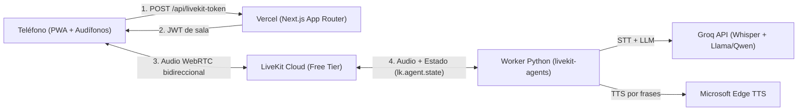

# Compañero de Voz

Compañero conversacional de voz en tiempo real diseñado para hablar por audífonos mientras trabajas en movimiento y con la pantalla del teléfono apagada, usando un stack 100% gratuito desplegable en **Vercel** (frontend + API de tokens) y **LiveKit Cloud + Groq + Edge TTS** (worker de voz).

## Arquitectura



## Estructura del monorepo

```text
.
├── web/                  # Frontend Next.js 15 + PWA + endpoint de tokens para Vercel
│   ├── app/
│   │   ├── api/livekit-token/route.ts
│   │   ├── globals.css
│   │   ├── layout.tsx
│   │   └── page.tsx
│   ├── components/
│   │   ├── ServiceWorkerRegister.tsx
│   │   └── VoiceCompanion.tsx
│   ├── lib/
│   │   ├── audio.ts
│   │   └── mediaSession.ts
│   ├── public/
│   │   ├── icons/
│   │   ├── icon.svg
│   │   ├── manifest.json
│   │   └── sw.js
│   ├── scripts/generate-icons.mjs
│   ├── .env.example
│   ├── next.config.mjs
│   └── package.json
├── agent/                # Agente de voz en tiempo real (Python + LiveKit Agents)
│   ├── tests/test_text_utils.py
│   ├── .dockerignore
│   ├── .env.example
│   ├── Dockerfile
│   ├── agent.py
│   ├── edge_tts_plugin.py
│   ├── prompts.py
│   ├── requirements-dev.txt
│   ├── requirements.txt
│   └── text_utils.py
├── render.yaml           # Blueprint opcional para desplegar el agente en Render
└── README.md
```

---

## 1. Obtener las claves gratuitas

### Groq API (`GROQ_API_KEY`)
1. Entra a [console.groq.com](https://console.groq.com) y crea una cuenta o inicia sesión.
2. Ve a **API Keys** → **Create API Key**, asigna un nombre y copia la clave.
3. Consulta los límites gratuitos vigentes (solicitudes por minuto/día y tokens) directamente en [console.groq.com/settings/limits](https://console.groq.com/settings/limits).

### LiveKit Cloud (`LIVEKIT_URL`, `LIVEKIT_API_KEY`, `LIVEKIT_API_SECRET`)
1. Entra a [cloud.livekit.io](https://cloud.livekit.io) y crea un proyecto nuevo.
2. El plan gratuito (**Build**) incluye un cupo de minutos mensuales; revisa los límites vigentes en el panel de facturación o precios de LiveKit Cloud.
3. Ve a **Settings** → **API Keys**, genera una clave si no tienes una, y copia:
   - **WebSocket URL** (`wss://tu-proyecto.livekit.cloud`) → `LIVEKIT_URL`
   - **API Key** → `LIVEKIT_API_KEY`
   - **API Secret** → `LIVEKIT_API_SECRET`

---

## 2. Ejecución en local

### Levantar el agente (`agent/`)

Requiere Python 3.10 o superior:

```bash
cd agent
python -m venv .venv
# En Windows PowerShell: .venv\Scripts\Activate.ps1
# En Linux/macOS: source .venv/bin/activate
pip install -r requirements.txt
cp .env.example .env
# Edita .env con tus claves de LiveKit Cloud y Groq
python -m livekit.agents download-files
python agent.py dev
```

Cuando esté listo verás un mensaje en consola indicando que el worker quedó registrado (`registered worker`).

### Levantar el frontend (`web/`)

```bash
cd web
npm install
cp .env.example .env.local
# Edita .env.local con LIVEKIT_URL, LIVEKIT_API_KEY y LIVEKIT_API_SECRET
npm run dev
```

Abre `http://localhost:3000` en tu navegador (el micrófono funciona en `localhost` sin HTTPS). Para usarlo desde el teléfono en la calle necesitas HTTPS, por lo que conviene desplegar `web/` en Vercel.

---

## 3. Desplegar `web/` en Vercel

### Opción A: Desde el Dashboard de Vercel
1. Sube este repositorio a GitHub.
2. En Vercel, elige **Add New… → Project** e importa tu repositorio.
3. En **Root Directory**, selecciona `web`.
4. En **Environment Variables**, añade:
   - `LIVEKIT_URL`
   - `LIVEKIT_API_KEY`
   - `LIVEKIT_API_SECRET`
   - *(Opcional)* `APP_ACCESS_CODE` (si quieres proteger tu despliegue con un código para que nadie más consuma tus minutos).
5. Haz clic en **Deploy**.

### Opción B: Desde Vercel CLI

```bash
cd web
npx vercel
npx vercel env add LIVEKIT_URL
npx vercel env add LIVEKIT_API_KEY
npx vercel env add LIVEKIT_API_SECRET
# Opcional: npx vercel env add APP_ACCESS_CODE
npx vercel --prod
```

---

## 4. Desplegar `agent/` en la nube (Tier gratuito)

Vercel Serverless tiene límites de ejecución cortos y no permite mantener un worker WebRTC conectado permanentemente, por lo que `agent/` se ejecuta como un proceso continuo aparte.

### Opción A: Koyeb (Free Tier con Dockerfile)
1. En Koyeb, crea un nuevo **Web Service** conectado a tu repositorio de GitHub.
2. Selecciona **Builder: Dockerfile** y establece el directorio raíz / contexto en `agent`.
3. Elige la instancia **Free** (`512 MB RAM`).
4. Configura el puerto **8081** y el health check HTTP en `/`.
5. Añade las variables de entorno: `LIVEKIT_URL`, `LIVEKIT_API_KEY`, `LIVEKIT_API_SECRET`, `GROQ_API_KEY` y `AGENT_IDLE_PROCESSES=1`.

### Opción B: Render (Blueprint con `render.yaml`)
1. En Render, ve a **New → Blueprint** y conecta tu repositorio (detectará `render.yaml` en la raíz automáticamente), o crea un **Web Service** con runtime **Docker**, `Root Directory: agent` y plan **Free**.
2. El health check HTTP de LiveKit Agents responde en `/`.
3. Completa las variables secretas solicitadas (`LIVEKIT_URL`, `LIVEKIT_API_KEY`, `LIVEKIT_API_SECRET`, `GROQ_API_KEY`).

> **Advertencia sobre planes gratuitos PaaS (Render / Koyeb):**
> - Las instancias gratuitas tienen alrededor de **512 MB de RAM**, por lo que se recomienda mantener `AGENT_IDLE_PROCESSES=1` para no exceder la memoria.
> - Las instancias gratuitas pueden suspenderse o escalar a cero por inactividad. En particular, **Render Free** duerme el servicio tras unos 15 minutos sin tráfico HTTP entrante, y la conexión WebSocket saliente del agente hacia LiveKit Cloud no cuenta como tráfico entrante. Al despertar puede tardar entre 30 y 60 segundos en reconectar.

### Alternativas siempre encendidas
- **Oracle Cloud Always Free VM** con Docker:
  ```bash
  cd agent
  docker build -t companero-agent .
  docker run -d --restart unless-stopped --env-file .env -p 8081:8081 companero-agent
  ```
- **LiveKit Cloud Agents (`lk agent create`)**: permite alojar el worker directamente en LiveKit Cloud; revisa en tu panel si tu plan actual lo incluye.

### Comandos Docker locales

```bash
cd agent
docker build -t companero-agent .
docker run --rm --env-file .env -p 8081:8081 companero-agent
```

---

## 5. Instalar la PWA en el teléfono

- **Android (Chrome):** abre la URL de Vercel en Chrome, toca el menú `⋮` y selecciona **Instalar aplicación** (o *Añadir a pantalla de inicio*).
- **iOS (Safari):** abre la URL en Safari, toca el botón **Compartir** y selecciona **Añadir a pantalla de inicio**.

---

## 6. Pantalla apagada y control con audífonos

- **Cómo funciona:** al pulsar **Conectar**, la app inicia de forma síncrona un audio WAV casi silencioso en bucle (`KeepAlive`, ~-84 dBFS) y configura `navigator.mediaSession` con `playbackState = 'playing'`. Esto le indica al sistema operativo móvil que hay una sesión multimedia activa para que no suspenda el audio ni el WebRTC al apagar la pantalla, y enlaza el botón **Play/Pausa** de los audífonos Bluetooth para silenciar o reactivar el micrófono (con tonos de confirmación y vibración).
- **Android + Chrome:** ofrece la mejor estabilidad en segundo plano con la pantalla apagada. Se recomienda desactivar la optimización de batería para Chrome en los ajustes de Android.
- **iOS / WebKit:** Safari y especialmente las PWAs instaladas en iOS pueden suspender la captura de micrófono al bloquear la pantalla o cambiar de app. Es una limitación conocida del motor WebKit; si usas iPhone, prueba primero directamente desde Safari.

---

## 7. Ajustes disponibles (`agent/.env`)

| Variable | Por defecto | Descripción |
| :--- | :--- | :--- |
| `GROQ_LLM_MODEL` | `qwen/qwen3.8-27b` | Modelo de lenguaje en Groq (otras opciones activas: `openai/gpt-oss-120b`, `openai/gpt-oss-20b`). |
| `EDGE_TTS_VOICE` | `es-CL-LorenzoNeural` | Voz neuronal de Edge TTS (por ejemplo `es-ES-AlvaroNeural`, `es-MX-JorgeNeural`, `es-AR-TomasNeural`). |
| `EDGE_TTS_RATE` | `+5%` | Velocidad de locución (`+0%`, `+10%`, `-5%`, etc.). |
| `VAD_ACTIVATION_THRESHOLD` | `0.6` | Sensibilidad de detección de voz de Silero VAD (subir a `0.65`–`0.7` si hay mucho viento). |
| `VAD_MIN_SILENCE` | `0.6` | Segundos de silencio para dar por terminado un turno de voz. |
| `AGENT_IDLE_PROCESSES` | `1` | Procesos precalentados en espera (mantener en `1` en contenedores de 512 MB). |
| `PORT` | `8081` | Puerto HTTP de salud del worker (`/`) para plataformas cloud. |

---

## 8. Solución de problemas

- **El agente no entra a la sala ("Esperando al compañero…" indefinidamente):**
  1. Revisa los logs del worker y verifica que aparezca `registered worker`.
  2. Comprueba que `web/` y `agent/` usen exactamente el mismo `LIVEKIT_URL`, `LIVEKIT_API_KEY` y `LIVEKIT_API_SECRET`.
  3. Verifica que no hayas configurado un `agent_name` en `agent.py` (el código usa despacho automático).
- **No se escucha la respuesta ("Toca para activar el audio"):** algunos navegadores bloquean el autoplay si el permiso falló; toca una vez el botón gigante del centro para ejecutar `room.startAudio()`.
- **`edge-tts` devuelve error 403 o `NoAudioReceived`:** Microsoft actualiza ocasionalmente las cabeceras del endpoint; actualiza el paquete con `pip install -U edge-tts`.
- **La API responde HTTP `401` al conectar:** tienes definida la variable `APP_ACCESS_CODE` en Vercel; ingresa el código configurado cuando la app lo solicite (si ya guardaste uno antiguo en el navegador, limpia los datos del sitio o vuelve a introducirlo).
